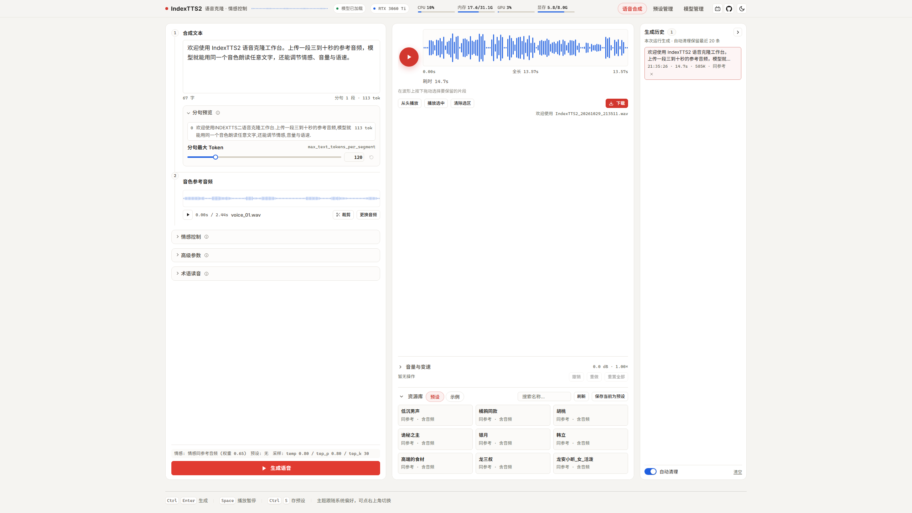
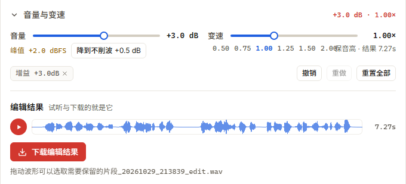
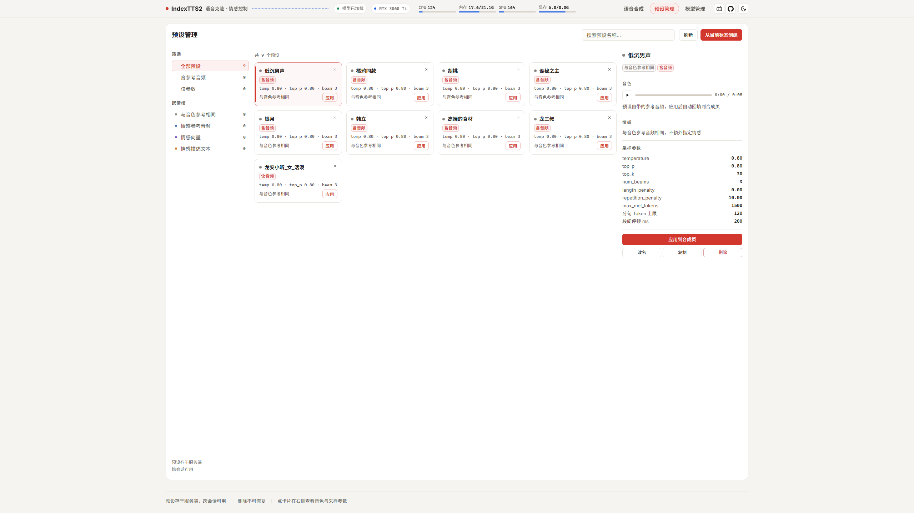
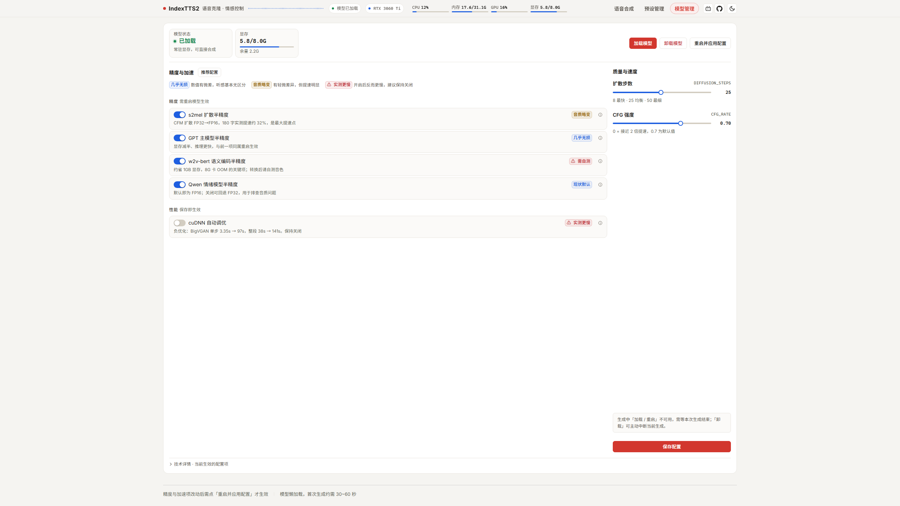
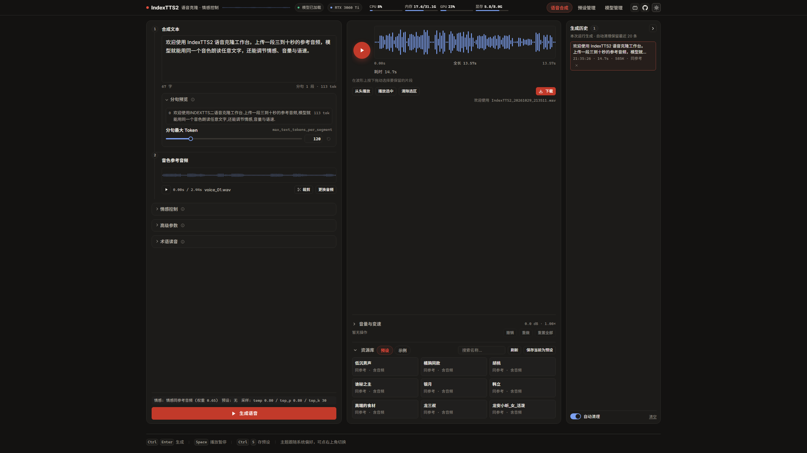

# IndexTTS2 Studio · 本地语音合成工作台

> **作者 / 维护者：B站 [@十一君Jun](https://space.bilibili.com/470166715)**
>
> 视频演示与更新动态都在 B 站，问题反馈也可以直接在那边留言。

基于 [IndexTTS2](https://github.com/index-tts/index-tts) 官方模型的本地化改造版：把官方的 gradio WebUI 换成一套 **FastAPI + 原生 JavaScript** 的本地工作台 —— 服务秒开、空闲不占显存、生成过程有五步实时进度、结果带波形播放与「裁剪 / 音量 / 变速」剪辑台，预设与术语读音都能存下来复用。

**RTX 3060 Ti 8GB 实测**：长文本整段耗时相对上游缩短约 7 倍（RTF 11.87 → 1.31），模型加载后常驻显存约 5.6 GB（三项 FP16 全开），8 GB 显卡仍有约 2.5 GB 余量，可以稳定出片。

另外自带一个 **AI Agent Skill**（`skills/indextts2-tts/`）：装进DSH / WorkBuddy / Claude Code 之后，直接说「用胡桃的音色把这段稿子念出来」就行 —— agent 自己探活、选音色、合成、把音频路径交回来，长文还能自动分段批量跑。详见 [AI Agent Skill](#ai-agent-skill让-ai-直接调用这套服务)。

---

## 界面预览

### 语音合成（三栏工作区）



左侧是「文本 → 参考音频 → 情感 / 高级参数 / 术语」的操作流，中间是生成结果与编辑区，右侧是本次运行的生成历史。Header 常驻显示模型状态与 CPU / 内存 / GPU / 显存仪表。

### 音频剪辑台



拖动波形选保留片段，音量 -24 ~ +24 dB（实时显示峰值 dBFS，削波时可一键拉到无损上限），变速 0.5 ~ 2.0 倍保音高，全程可撤销 / 重做，源音频与编辑结果分开下载。

### 预设管理与模型管理

| 预设管理 | 模型管理 |
|---|---|
|  |  |

### 深色主题

<details>
<summary>点开查看深色主题</summary>



</details>

---

## 相对官方上游改了什么

| 维度 | 官方上游 | 本项目 |
| --- | --- | --- |
| WebUI | gradio（`webui.py`），启动即加载模型 | FastAPI + 原生 JS，无框架 / 无构建 / 无 npm；模型懒加载，空闲显存为零 |
| 推理速度 | BigVGAN 调用漏了 `no_grad()`，单步 128 秒，RTF ≈ 11.9 | 补齐 `no_grad` + 整链路 `no_grad`，单步 0.33 秒，RTF ≈ 1.3 |
| 显存 | 全量 FP32 权重常驻，8GB 卡余量紧张 | 4 项半精度旋钮 + Qwen 情感模型懒加载，8GB 卡可稳定运行 |
| 加速选项 | 8 个开关，含 flash-attn / torch_compile / deepspeed | 精简为 5 个开关 + 2 个参数（扩散步数、CFG 强度），实测负优化与厂商绑定的项全部移除 |
| 生成任务 | gradio 内置队列，用户不可见、不可控 | 排队位次、排队可取消、生成中可停止、刷新页面自动找回任务 |
| 结果处理 | 只能下载原始音频 | 波形选区、音量、保音高变速、撤销重做、源文件与编辑结果分开下载 |
| Agent 集成 | 无（只有 gradio 界面和 Python API） | 自带 agent skill：纯标准库客户端，25 个子命令，支持批量与上游 Skill 编排 |
| 重复合成 | 参考音频按随机 uuid 存盘，预处理缓存永不命中 | 参考音频按内容 md5 存盘，同一声色第二次起跳过特征提取 |
| 安全 | 默认对外监听 | 默认只绑 `127.0.0.1`，且所有文件路径取 `basename` |

---

## 核心特性

| 特性 | 说明 |
| --- | --- |
| 秒启动 · 空闲零显存 | 服务毫秒级启动，主模型与 Qwen 情感模型均懒加载，空闲时显存占用为 0；带 Qwen 的完整功能比常驻方案省约 1.5 GB |
| 实时生成进度 | SSE 流式推送：模型加载 → 参考音频特征 → GPT 语音生成 → 声学模型合成 → 声码器解码，五步状态面板 + 进度条 + 实时耗时 |
| 音频剪辑台 | 波形拖选裁剪、音量（-24~+24 dB，峰值 dBFS 实时回显、削波一键修正）、变速（0.5~2.0 倍保音高），支持撤销 / 重做（50 步），源音频与编辑结果分开下载 |
| 参考音频裁剪 | 独立裁剪弹窗：拖动把手选区、整体平移、选区外重框、Shift 精细模式，选区外点一下不会清空原选区；裁完可直接存成预设 |
| 声纹波形播放 | 参考音频与生成结果都渲染波形，点击 / 拖动定位播放位置 |
| 任务管理 | 排队位次提示、排队可取消、生成中可停止（独立终态，不记为失败）、刷新页面自动找回本页签任务 |
| 生成历史 | 右侧边栏记录本次运行，最多保留 20 条；被挤出条目的音频在「自动清理」开启时一并删除；点击回填播放器 |
| 预设系统 | 参考音频 + 全部参数保存为预设，一键回填复用，支持改名 / 复制 / 删除；服务端存储，跨会话可用 |
| 预设管理页 | 三栏工作台：左侧按「含音频 / 仅参数 / 四种情绪模式」筛选、中间卡片墙、右侧检视面板（内置试听、参数全览、应用到合成页）；点卡片只选中不跳走 |
| 参数锁定 | 锁定高级参数后，应用预设 / 刷新页面都不会覆盖当前数值；锁定状态存服务端 |
| AI Agent Skill | 自带 `skills/indextts2-tts`：零依赖客户端 + 25 个子命令，一句话让 agent 完成「探活 → 选音色 → 合成 → 交路径」，支持批量清单、断点续跑与上游 Skill 编排 |
| 内置示例 | 9 条示例一键填充文本与参数（另有 2 条情感文本示例默认隐藏），用于快速试听音色 |
| 情感控制 | 四种模式：同参考音频 / 情感参考音频 / 8 维情感向量（滑块直控、权重可缩放）/ 情感文本描述（Qwen）；参考音频超过 15 秒时提示仅取前 15 秒，并可直接打开裁剪弹窗截出目标片段 |
| 术语词汇表 | 自定义术语读音（落盘 `checkpoints/glossary.yaml`），支持单条删除、一键清空，以及默认关闭的「级联替换」开关 |
| 文本与分句调节 | 文本长度软提示（2000 字起警告、10000 字硬限）；分句最大 Token 与段间停顿（10~500 毫秒）可调，分句预览实时回显 |
| 深色 / 浅色主题 | 一键切换并记忆；主题在首屏绘制前就已确定，深色刷新不闪白 |
| GPU 仪表自适配 | Header 的 GPU 利用率与显存走「进程内 NVML → `nvidia-smi` → NVIDIA 老式安装目录（`NVSMI`）」三级通道，驱动较旧或 `nvidia-smi` 不在 PATH 的机器也能读到；某一项读不到只隐藏那一项，设备名显示 `--` 而不是误报成 CPU |
| 输入不丢 | 文本、情感、全部参数存 localStorage，参考音频本体存 IndexedDB，刷新后原样恢复 |
| FP16 加速矩阵 | 默认启用 gpt / s2mel / w2v 半精度推理，节省显存提升速度；qwen 情感模型本身以 FP16 加载 |

---

## 性能优化：做了什么、快了多少

以下数据来自 RTX 3060 Ti 8GB（Ampere / cu128）实测，同一文本、同一参考音频。

### 1. BigVGAN 补上 `no_grad()`（收益最大的单项）

**现象**：一条 12.8 秒的音频要跑 151 秒，其中声码器（BigVGAN）一步就占 128 秒 —— 相当于整条流水线 85% 的时间卡在最后一步。

**原因**：推理链路里 GPT 生成与扩散都包在 `torch.no_grad()` 内，唯独 BigVGAN 调用漏了，它一直按「训练模式」维护自动求导图，白算了几十层。

**改法**：在 `indextts/infer_v2.py` 的 BigVGAN 调用处补上 `with torch.no_grad():`，不改变任何数值与权重。

| 指标 | 修复前 | 修复后 |
| --- | --- | --- |
| BigVGAN 单步 | 128.0 s | **0.33 s**（约 380 倍） |
| 整段耗时（12.77 s 音频） | 151 s | **~21 s** |
| RTF（生成秒 / 音频秒） | 11.87 | **1.31** |

同时给推理主入口 `infer_generator` 整体加了 `@torch.no_grad()`，把「逐段手工包裹」升级为整函数默认关闭梯度，杜绝同类问题再次出现。

### 2. 半精度矩阵：从 1 项扩到 4 项

官方只暴露了 GPT 主模型的 `use_fp16`。本项目把另外三个模型也做成独立开关，配置从 `start_server.bat` 到「模型管理」页全链路可用：

| 开关 | 作用 | 实测效果 |
| --- | --- | --- |
| `fp16` | GPT 主模型半精度 | 显存减半、推理更快，几乎无损 |
| `s2mel_fp16` | 扩散模型 FP16 | 180 字长文本 75.8 s → **51.4 s（-32%）**，实测中唯一有效的「开启式」提速 |
| `w2v_fp16` | w2v-bert 语义编码器 FP16 | **省约 1 GB 显存**，8GB 卡最大的单项显存节约，开启后建议试听音色 |
| `qwen_fp16` | Qwen 情感模型 FP16 | 该模型本就以 float16 加载，此项把现状显式化；关闭可回退 FP32 排查音质 |

设备侧自动降级：CPU 上自动关 `fp16`，Apple MPS 上自动关 `fp16`（MPS 上反而更慢），不需要人工干预。

### 3. 参考音频缓存复用

模型本身有参考音频预处理缓存（同一路径 + 实例存活时跳过 W2V-BERT / RepCodec / mel / CAMPPlus），但旧版每次上传都存成 `spk_{随机uuid}.wav`，路径必然不同，缓存永远打不中 —— 同一个音色反复被重算，`prompts/` 目录还越堆越大。

改成按内容 md5 命名后，同一段音频 → 同一个路径 → 第二次起直接命中缓存，前端「参考音频特征」那一步瞬间通过。启动时还会顺手清理旧 uuid 格式的历史文件。

### 4. 惰性加载与显存回收

- 主模型在第一个生成请求时才加载，服务本身秒开，空闲不占显存（官方 gradio 是启动即加载）。
- 「卸载模型」会把模型实例上的缓存引用全部清空，再 `gc.collect()` + `torch.cuda.empty_cache()` + `ipc_collect()`，显存立刻还回去。
- 「重启并应用配置」先释放旧实例再构造新实例，避免新旧模型短暂共存把 8GB 卡顶到 OOM。
- 生成中也可以安全卸载：会先中断本次生成，再回收显存。

### 5. 运行时可调的扩散参数

`diffusion_steps` 与 `inference_cfg_rate` 从模型内部常量提升为可在线调整的参数，改完即生效、不用重启：

| 参数 | 调整 | 效果 | 代价 |
| --- | --- | --- | --- |
| `diffusion_steps` | 25 → 10 | s2mel 31.2 s → **10.5 s** | 音质略变（建议 8~16） |
| `inference_cfg_rate` | 0.7 → 0 | s2mel 约再省一半 | 参考音频的风格跟随弱化 |
| `max_text_tokens_per_segment` | 120 → 更大 | 段数减少，每段固定开销摊薄 | 需配合 `max_mel_tokens` 防止截断 |

### 6. 砍掉负优化的加速项

上游带了一批加速开关（`tf32` / `cuda_kernel` / `accel` / `torch_compile` / `deepspeed` 等），逐项实测后删掉了 5 个「看似能开、实则有害」的：

| 已移除 | 原绑定 | 移除原因（实测） |
| --- | --- | --- |
| `accel`（flash-attn GPT 加速） | Ampere 系 | 8GB 卡上**反向加速**：短 50 字 344.5 s → 16.6 s（关掉后 -95%），长 180 字 174.6 s → 75.8 s（-57%） |
| `torch_compile` | Triton | 编译缓存后长文本仍要 ~890 s，首次还要现场编译 1~2 分钟，8GB 卡无收益 |
| `cuda_kernel` | 本地 CUDA 扩展 | BigVGAN 修复后，融合核对整体影响落在噪声范围内，不值当长期维护编译链 |
| `tf32` | NVIDIA Ampere+ | 代码没有架构检测，在 Turing 及更早的卡上静默无效，换机器不能照抄 |
| `deepspeed` | 仅 Linux | Windows 构建链依赖 Linux 专属组件，单卡推理收益本就有限 |

`cudnn_benchmark` 保留为可选项但**默认关闭**，因为它在 TTS 场景是明确的负优化：cuDNN 会为每个新的输入长度重新搜索卷积算法，而每次生成的音频长度都不一样。实测 BigVGAN 单步 3.35 s → 97.24 s，整段 38 s → 141 s（RTF 6.1 → 20.8）。

### 7. 优化后的耗时结构

| 场景 | 结果 |
| --- | --- |
| 短文本端到端 | Total 4.03 s / RTF 1.36 / BigVGAN 0.13 s |
| 长文本（180 字，`fp16 + s2mel_fp16`） | 51.4 s |
| 显存 | 三项 FP16 全开常驻约 5.6 GB；关掉 `w2v_fp16` 约 6.7 GB |

关掉 cuDNN 调优后，长文本的耗时大头是 s2mel（占整段 50~70%），所以想继续提速优先调扩散步数和 CFG 强度，而不是去折腾 GPT 层。

---

## 8GB 显卡推荐配置

`start_server.bat` 顶部就是配置区，默认值已经按 8GB 卡调好：

| 配置项 | 默认 | 说明 |
| --- | --- | --- |
| `FP16` | 1 | GPT 主模型半精度 |
| `S2MEL_FP16` | 1 | 扩散半精度，长文本提速最明显 |
| `W2V_FP16` | 1 | 省约 1 GB 显存，8GB 卡抗 OOM 的关键 |
| `QWEN_FP16` | 1 | Qwen 情感模型半精度（现状） |
| `CUDNN_BENCHMARK` | 0 | 实测更慢，保持关闭 |
| `DIFFUSION_STEPS` | 25 | 想更快可降到 10~16，音质略变 |
| `CFG_RATE` | 0.7 | 设 0 约再快一倍，参考风格跟随变弱 |

> 显存吃紧时先确认 `W2V_FP16` 是开着的 —— 它是单项收益最大的一项。

---

## 架构

### 服务端 `server.py`

FastAPI + uvicorn，纯后端（不再内嵌 UI），负责推理调度、任务簿记、文件与预设管理：

| 域 | 主要路由 |
| --- | --- |
| 系统 | `/health`、`/status`（模型状态 + 仪表合并端点）、`/metrics` |
| 模型 | `GET /model`、`POST /model/config`、`/model/load`、`/model/unload`、`/model/restart` |
| 生成 | `POST /tts`（SSE 流式）、`/tts/{id}/cancel`、`/tts/{id}/stop`、`/jobs/current`、`/jobs/{id}` |
| 音频 | `GET /audio/{name}`、`POST /audio/tempo`（保音高变速，纯 CPU、不占推理锁） |
| 历史 | `GET /history`、`POST /history/config`、`DELETE /history`、`DELETE /history/{id}` |
| 预设 | `GET/POST /presets`、`/presets/{name}`、`/presets/{name}/audio/{kind}`、`DELETE`、`/rename`、`/duplicate` |
| 辅助 | `/examples`、`POST /segments`（BPE 分句预览）、`/glossary`（术语读音与级联开关） |

正式路径为 `/api/v1/*`，旧根路径做 307 兼容重定向。默认只监听 `127.0.0.1`：服务有文件删除类端点且没有鉴权，需要局域网访问时请显式 `--host 0.0.0.0` 并自行评估风险。

### 前端 `web/`

`index.html` + `app.js` + `edit.js` + `clip.js` + `tip.js` + `style.css`，原生 JS，零构建、零 npm 依赖，改完刷新即可生效。三页结构（语音合成 / 预设管理 / 模型管理），Tab 状态写进 URL hash，刷新不丢当前页。字体（Inter + Noto Sans SC）已本地化到 `web/fonts/`，离线可用。

### 目录结构

```
index-tts/
├── server.py              # FastAPI 服务（推理调度 + 任务 + 文件接口）
├── start_server.bat       # 一键启动（顶部是加速配置区）
├── stop_server.bat        # 按端口停止服务
├── web/                   # 前端：index.html / app.js / edit.js / clip.js / tip.js / style.css / fonts/
├── docs/                  # 功能与流程总表、工程笔记、性能记录
├── skills/indextts2-tts/  # Agent Skill：纯标准库 TTS 客户端（见「AI Agent Skill」一节）
├── indextts/              # 模型与推理链路（infer_v2.py 为核心）
├── checkpoints/           # 模型权重 + config.yaml + glossary.yaml
├── examples/              # 内置示例音频与文本
├── prompts/               # 参考音频缓存（按内容 md5 命名）
└── outputs/               # 生成结果（启动时清理 14 天以上的旧文件）
```

---

## 快速开始

### 环境要求

- Windows 10 / 11
- NVIDIA 显卡（CUDA 12.8，≥ 8 GB 显存推荐）
- [Visual C++ 2015–2022 运行库 x64](https://aka.ms/vs/17/release/vc_redist.x64.exe)
- [git](https://git-scm.com/downloads)
- [uv](https://docs.astral.sh/uv/getting-started/installation/)（Python 3.10–3.11 由 uv 自动管理，无需手动安装）

> 启动时报 `_kaldifst` 的「DLL 初始化例程失败」，或 `torchaudio.pyd` 的「找不到指定的模块」，九成是缺上面那个运行库 —— Python 与 torch 的 C 扩展都依赖它。装完**重启**再启动服务；不要用 `pip` 去重装 torch 来“修”，那会破坏 `uv.lock` 锁好的版本对应关系。

### 1. 克隆仓库

```bash
git clone <本仓库地址>
cd index-tts
```

### 2. 安装依赖

```bash
uv sync --extra server
```

依赖版本由 `uv.lock` 锁定，安装结果与开发环境一致。

### 3. 下载模型

从官方渠道下载 IndexTTS2 权重，放入 `checkpoints/` 目录：

| HuggingFace | ModelScope |
| --- | --- |
| [IndexTTS-2](https://huggingface.co/IndexTeam/IndexTTS-2) | [IndexTTS-2](https://modelscope.cn/models/IndexTeam/IndexTTS-2) |

仓库已自带 `config.yaml` 等小文件，只需补齐权重：

```
checkpoints/
├── gpt.pth
├── s2mel.pth
├── bpe.model
├── config.yaml
├── pinyin.vocab
├── feat1.pt / feat2.pt / wav2vec2bert_stats.pt
├── qwen0.6bemo4-merge/        # Qwen 情感模型
└── hf_cache/                  # bigvgan、w2v-bert-2.0 等
```

> 国内下载可用 `HF_ENDPOINT=https://hf-mirror.com`（启动脚本已默认设置），或直接走 ModelScope。

### 4. 启动

双击 **`start_server.bat`**，脚本会自动结束旧实例、等待端口就绪并打开浏览器：

```
http://127.0.0.1:7860
```

停止服务：双击 **`stop_server.bat`**。其他平台可用 `uv run --extra server python server.py`（启动脚本本身是 Windows 批处理）。

---

## 使用要点

**三个页面**：语音合成（日常用）、预设管理（音色与参数的组合存档）、模型管理（加载 / 卸载 / 重启 + 加速选项）。

**生成流程**：输入文本 → 拖入 3~10 秒参考音频（录音超过 15 秒可点「裁剪」截出目标片段）→ 需要的话展开「情感控制」选模式 → 点「生成语音」。首次生成要先加载模型（约 20~60 秒，有进度提示），之后模型常驻显存。

**快捷键**：`Ctrl+Enter` 生成 · `Space` 播放 / 暂停 · `Ctrl+S` 保存当前为预设 · `Ctrl+Z` / `Ctrl+Shift+Z` 撤销 / 重做编辑。

**长文本**：文本超过 2000 字会给黄色提示，超过 10000 字才硬性拦截。分句预览下方可调「分句最大 Token」，段数越多每段的固定开销越高，太长建议分段生成再拼接。

**术语读音**：像 `IndexTTS2`、`CAMPPlus` 这类词直接写进术语表，分别给中文读法和英文读法；默认只替换原文（不连锁），需要把读音继续套用其它术语时再打开「级联替换」。

---

## AI Agent Skill：让 AI 直接调用这套服务

仓库自带一个 agent skill —— `skills/indextts2-tts/`。装到支持 Skill 的 agent（WorkBuddy / Claude Code 这类）之后，你只要说「用胡桃的音色把这段稿子念出来」，agent 会自己探活、列音色、合成、把音频路径交回来，不用你记接口字段，也不用自己拼 multipart 请求。

它只覆盖「文字 → 语音」这一层，不碰长篇工作台的编辑工程层；**不 import 项目代码，只走 HTTP**，所以本机、远程服务器、Docker、反向代理后面都能用。

手上没有整合包的人问起来，它也不会含糊：明说「只有 skill 跑不出声音」，再把三条获取路径摆出来（给路径 / 双击启动后反查端口 / 去 [B 站 @十一君Jun](https://space.bilibili.com/470166715) 按视频说明取包）。

### 为什么不是随手包一层 HTTP

| 项 | 做法 |
| --- | --- |
| 依赖 | 纯标准库，零第三方依赖，Python 3.10+ 即可；客户端是单文件 `tts_client.py` |
| 地址 | 全走环境变量（`INDEXTTS_URL` / `INDEXTTS_OUT_DIR` 等 7 个），换端口或连远程只改一个值 |
| 路径 | 不 `cd`、不假设 cwd；`locate` 从端口反查包根，找不到就把三条路摆给用户选，不自己瞎猜 |
| 代理 | 默认绕过 `HTTP_PROXY` —— agent 沙箱里的全局代理会把发往 `127.0.0.1` 的请求也劫走，报 `502` 看着像服务挂了，实际服务好好的 |

### 三条硬规则：写进代码，而不只是写在文档里

1. **生成前必须确认音色**。既没 `--preset` 也没 `--voice` 时，脚本打出候选清单并以**退出码 2** 中止。agent 必须停下来问人，不允许自作主张挑一个。
2. **禁止并行生成**。服务端是全局单锁 + 队列，客户端再加一把文件锁（`--lock-wait`），避免多条命令互相挂死。
3. **音频必须可找回**。不传 `--out` 也会落到 `<输出目录>/<日期>/` 并写 `last.json`，`last` 子命令随时取回上一次的结果。

### 能力：25 个子命令

| 分组 | 命令 |
| --- | --- |
| 定位与启动 | `locate`（找项目根，退出码 3 = 请用户选路）· `ensure`（没跑就拉起来并等就绪）· `health`（连不上时区分「没监听 / 在加载 / 端口被占 / DNS 错」四种原因）· `status`（模型状态 + 显存仪表） |
| 模型与显存 | `model` · `model-config`（改扩散步数与 CFG，即时生效）· `model-restart` · `unload`（释放显存） |
| 音色 | `presets` · `preset` · `preset-save`（把一段录音存成命名音色）· `examples`（内置示例）· `choose` |
| 合成 | `synth` · `segments`（长文分段，可直接产出批量清单）· `batch` · `tempo`（保音高变速，不重算）· `stop` · `last` · `history` |
| 读音与自检 | `glossary`（术语增删查）· `doctor`（端到端体检）· `capabilities` · `api`（接口对账，查整合包升级后有没有漂移）· `selftest` |

几条比较实用的：

- **`doctor` 而不是「能不能用」**：探活 → 接口 → **真合成一句** → 对这句变速一次，输出 `ready: true` 且退出码 0 才算能开工。只证明接口能连的 `selftest` 不算数。
- **`api` 对账**：拉服务端 `openapi.json` 跟脚本已适配的清单比对，列出「服务端有但没适配」与「脚本在调但服务端没有」，整合包升级后这是唯一的漂移探针。
- **`tempo` 先于重新合成**：用户嫌快/嫌慢，先 `tempo --rate 1.2` 变速，不重新推理、不占 GPU，只有音质不可接受才重录。

### 批量：给几十上百句用的

```bash
python skills/indextts2-tts/scripts/tts_client.py segments --text-file 长文.txt --out tasks.json --preset "胡桃"
python skills/indextts2-tts/scripts/tts_client.py batch -f tasks.json --resume
```

- 输入是 `{"defaults": {...}, "items": [{"id","text"}...]}`，`id` 决定文件名、也是回指的唯一键，**撞车（含归一化后同名）在合成前就拦截**，不会让你拿到两份一样的音频；
- 单条失败不中断，跑完汇总；`--fail-fast` 改成遇错即停；
- **`manifest.json` 每完成一条就刷新**（含 `duration`、采样率、路径），进程被 Ctrl-C 也留得住，`--resume` 按**内容指纹**跳过没变的句子，`--only id` 只重跑指定句；
- 时长是客户端读 wav 头量出来的 —— 服务端的事件流不带时长，对齐时间轴要靠它。

### 给上游 Skill 编排（视频配音 / 有声书）

置 `INDEXTTS_HEADLESS=1`，凡是「需要问人」的地方 stdout 变成 JSON、人类提示走 stderr：缺音色返回 `{"ok":false,"need":"voice","presets":[...]}` 退出码 2，缺项目根返回 `need:"project_dir"` 退出码 3，批量 id 撞车返回 `reason:"duplicate_ids"` 退出码 1。上游只看退出码 + JSON，**不要靠解析文案判断状态**；动手前先跑一次 `capabilities`，音色清单、情感模式、文本/音频上限、并发语义一次拿全。

### 装法

```bash
# 仓库内直接可用，不需要安装
python skills/indextts2-tts/scripts/tts_client.py --version     # indextts2-tts 1.2.2

# 装成用户级 Skill，任意工作目录都能用
# Git Bash / macOS / Linux
cp -r skills/indextts2-tts ~/.workbuddy/skills/     # Claude Code 用户改 ~/.claude/skills/
# Windows cmd
xcopy /E /I skills\indextts2-tts "%USERPROFILE%\.workbuddy\skills\indextts2-tts"
```

装好后随口问就行：

| 你说 | 它做什么 |
| --- | --- |
| 「现在能不能出声？」 | `doctor` 体检，附一条试听样本 |
| 「把这篇 3000 字念成有声书」 | `segments` 分段 → `batch` 一次跑完，回传每句时长 |
| 「这段用龙三叔的声音」 | 查预设 → `synth --preset`，没有就让你先选 |
| 「第 12 句太快了」 | `batch --only` 重跑那一句，其它不动 |
| 「`IndexTTS2` 总念错」 | 往术语表加一条读音 |

### Skill 目录（`skills/indextts2-tts/`）

| 文件 | 内容 |
| --- | --- |
| `SKILL.md` | 主文档：三条硬规则、标准流程、25 个子命令、排障 |
| `scripts/tts_client.py` | 客户端本体，单文件、纯标准库 |
| `references/api.md` | 全部 HTTP 端点、SSE 事件字段、状态码语义、预设目录结构 |
| `references/parameters.md` | `/tts` 全部表单字段、四种情感模式、采样参数与调参建议 |
| `references/pitfalls.md` | 实测踩坑清单（含沙箱 / 代理 / 中文路径） |
| `tests/test_client.py` | 离线回归测试：假服务、不需要 GPU，改脚本后先跑这个（当前 38 项全过） |

### 它不做什么

预设的删除 / 改名 / 复制、历史清理属于「AI 判断不了」的整理工作，归人；长篇台本工作台的 81 个 `/lf/*` 接口与 31 个时间轴接口是编辑工程层，不在这一层；`/jobs/*` 强制要浏览器生成的 `client_id`，脚本拿不到，也不封装。

---

## 常见问题

- **首次合成很慢？** 主模型懒加载，首次请求需约 20~60 秒加载进显存（8 GB 卡实测 18 秒，冷启动含预热会更久），界面有进度提示；加载后会**一直驻留**（不会自动卸载），要释放显存请在「模型管理」页点「卸载模型」。
- **GPU / 显存仪表显示 `--`？** 设备名显示 `--` 表示没读到 NVIDIA 显卡信息。程序会依次尝试进程内 NVML、`nvidia-smi`、老式安装目录（`C:\Program Files\NVIDIA Corporation\NVSMI\`），三条都失败才留空；常见原因是本机不是 N 卡，或服务启动时驱动还没就绪（15 秒后会自动重试，重启服务即可）。仪表缺失只影响显示，不影响推理。
- **显存不够？** 启动脚本默认已开启 `--fp16 --s2mel_fp16 --w2v_fp16` 与 25 步扩散；仍吃紧就确认 `w2v_fp16` 是开的（省约 1GB），再把扩散步数降到 10~16、CFG 调到 0，并关掉其它吃显存的程序。
- **长文本很慢？** 耗时大头是 s2mel 扩散（占 50~70%），优先调扩散步数与 CFG 强度，调完即时生效，不用重启模型。
- **端口被占用？** 启动脚本会自动清理 7860 端口的旧进程；如需换端口，编辑 `start_server.bat` 中的 `--port` 参数。
- **想让局域网其它设备访问？** 用 `--host 0.0.0.0` 启动，但接口没有鉴权且包含文件删除能力，只在可信网络里这么做。
- **换音色后效果不对？** 参考音频 3~10 秒最稳；超过 15 秒只会取前 15 秒，页面会有提示。切到「情感参考音频」模式时，情感音频和音色音频是两份不同的文件。

---

## 生态与扩展

### 全能音声工作台 · IndexTTS2 长篇台本与全流程音声制作扩展

> **项目地址：[Mars-1438/indextts2-longform-workbench](https://github.com/Mars-1438/indextts2-longform-workbench)**
>
> 作者：Mars-1438 · 当前版本 v0.19（2026-10-27）· 本项目代码以 MIT 发布

它不是一个新模型，也不是独立的 TTS 软件，而是**挂在本整合包上的扩展补丁**：装好后首页多出「长篇台本」入口，新增 `/longform`（台本工作台）、`/timeline`（多轨时间轴）、`/guide`（内置教程）三个页面，把「一份台本 → 逐句配音 → 多轨编排 → 混音交付」串成一条完整工作流。

本仓库擅长把**一句话**合成得很像，它补的是**一整本书/一部广播剧怎么生产**的那一段。

**它覆盖的环节**

| 环节 | 能力 |
| --- | --- |
| 台本整理 | 时间轴稿 / 剧本 / 小说 / 指令 / 纯文本五类稿子自动识别，三种分行方案，按章节、角色、场景分组，逐段预览与拆分合并，句内音效标记（位置 + 延迟） |
| 批量配音 | 每句独立生成、试听、重做；按分组配角色音色与情感；选中行 / 未生成 / 全文批量生成；修改追踪；多选批量删除复制（可连音频一起复制） |
| 素材处理 | 音视频导入（视频抽音轨）、去伴奏、中置提取、降噪、响度标准化、裁剪；处理结果沉淀到音色库 / 音效库，默认保留原始素材 |
| 多轨时间轴 | 拖拽移动、裁剪、框选与多选整组移动、按台本句序与句间停顿一键重排（只改开始时间，不重新生成）、片段音量 / 声像 / 淡入淡出 / 变速 / 定时长 |
| 空间音频 | 基于 HRIR（KEMAR / KU100 近场）的方位、仰角、距离控制，房间混响与干湿比，13 种运动脚本（左右往返、绕头圆周、掠过耳侧…），空间参数关键帧 |
| 自动化 | 音量、声像、空间距离三类关键帧曲线，支持边播边调把手动操作录成关键帧 |
| 混音与交付 | WAV / MP3 / FLAC / OGG 混音；REAPER 工程、PR / 达芬奇 EDL、Audacity 分轨 + 标签；可附带 stems、`timeline.csv`、`markers.csv` |
| 上手成本 | 内置离线图文教程（六步上手 + 全功能地图 + 快捷键 + 常见问题），不联网也能查 |

**值得用的几个理由**

- **不侵入主服务**：补丁只做三件事 —— 铺文件、在 `server.py` 里加两段 `try/except` 注册、首页加一行入口。扩展抛异常只记日志，不会拖垮主界面；`install.py --restore` 可以干净卸载。
- **只做编排层**：不训练模型、不替换推理，只要求 TTS 适配器提供 `state()` / `ensure_loaded()` / `normalize_emo_vec()` 和一个 `infer()`。理论上换个 TTS 也能接（仓库里有移植指南和自检清单）。
- **依赖克制、可离线**：后端只需 `fastapi / numpy / soundfile`；`scipy`（高质量重采样）、`h5py`（读 .sofa）、`torch + demucs`（去伴奏）缺失时自动降级而不是报错。ffmpeg 与 Demucs 权重随补丁内置，离线机器也能用。
- **数据就是文件**：台本、工程、素材、导出都在整合包的 `longform\` 与 `outputs\` 下，不写注册表、不写系统目录，整个包拷走即可迁移。
- **交付面向后期**：不是只能导一条总混音，而是能交出 REAPER 工程、EDL、分轨与时间码，方便进专业软件继续做。

**安装（三步）**

1. 先准备一个能正常启动的 **IndexTTS2.0 超级优化整合包 V3**（本仓库对应的分发版）；
2. 从该项目 Releases 下载补丁 zip，解压到整合包根目录（与 `server.py`、`runtime\` 同级），进目录双击 `安装.bat`；
3. 重启 `start_server.bat`，首页右上角会多出「长篇台本」，也可以直接访问 `http://127.0.0.1:7860/longform`、`/timeline`、`/guide`。

> 许可边界：工作台自身代码是 MIT，但**不包含也不授权**模型、整合包、Demucs 权重与 ffmpeg 二进制；HRIR 数据（KEMAR / KU100 近场）另有授权要求，商用前请按其 `assets/hrir/README.md` 与 CREDITS 逐项确认。

**关于这位小伙伴**

这个项目由 **Mars-1438** 独立完成方向规划、功能设计与开发实现（代码大量借助 DeepSeek 辅助），从 2026-10-22 的 v0.10 到 10-27 的 v0.19，六天迭代了十个版本 —— 台本编辑、时间轴、空间音频、混音导出、内置教程，都是一版一版补出来的。

更难得的是他把边界写得很清楚：整合包、模型、安装环境的问题指向本仓库，工作台自身的 bug 留在自己那边，两边各归各处。

**谢谢 Mars-1438 为 IndexTTS2 生态补上了「长篇生产」这一环。** 如果你正好要做有声书、广播剧、ASMR 或游戏语音，建议直接去他的仓库看看。

---

## 许可证

本仓库是 [IndexTTS2](https://github.com/index-tts/index-tts) 的衍生修改版，遵循其原始的 [bilibili Model Use License Agreement](LICENSE)（中文版见 [LICENSE_ZH.txt](LICENSE_ZH.txt)，两种语言版本如有冲突以中文版为准）。使用本仓库即表示你已阅读并同意该协议的全部条款。

按协议 4.1(a) 条要求声明：

> Any modifications made to the original model in this Derivative Work are not endorsed, warranted, or guaranteed by the original right-holder of the original model, and the original right-holder disclaims all liability related to this Derivative Work.
>
> 本衍生品对原模型的修改未经原权利人（bilibili Index Team）认可、担保或保证，原权利人对本衍生品及其相关的一切不承担任何责任。

---

## 致谢

- 上游项目：[IndexTTS / IndexTTS2](https://github.com/index-tts/index-tts)（IndexTeam）
- 模型：[IndexTTS-2 @ HuggingFace](https://huggingface.co/IndexTeam/IndexTTS-2) / [ModelScope](https://modelscope.cn/models/IndexTeam/IndexTTS-2)
- 变速引擎：[audiotsm](https://pypi.org/project/audiotsm/)（WSOLA 算法，MIT，保音高不变调）
- 生态扩展：[全能音声工作台](https://github.com/Mars-1438/indextts2-longform-workbench)（Mars-1438，长篇台本 / 多轨时间轴 / 混音导出，见上一节）

---

## 关于作者

**B站：[@十一君Jun](https://space.bilibili.com/470166715)**

这个仓库的本地化改造（WebUI 重构、推理优化、剪辑台、预设与术语系统）都是在这套 8GB 显卡的机器上一点点调出来的，实测数据和踩坑记录都写在上面的「性能优化」一节里。如果它对你有用，欢迎到 B 站点个关注、投个币。
