# IndexTTS2 Studio · 使用指南

> 面向使用者的说明书：每个功能是干什么的、怎么操作、参数调了会怎样，以及出问题先查哪里。
> 本文按 2026-11-01 的界面与代码整理，不含开发者向的接口细节。

---

## 0. 先看这里：运行配置与素材格式

### 0.1 电脑需要什么

| 项目 | 要求 | 说明 |
|---|---|---|
| 系统 | Windows 10 / 11 64 位 | 整合包按 Windows 打包，源码运行也以 Windows 为准 |
| 显卡 | NVIDIA 独显，**6 GB 显存能跑，推荐 8 GB 起** | 需要 CUDA 12.8；显存越紧，能开的候选数 / 批处理档位越小 |
| 内存 | 16 GB 起，32 GB 更稳 | 模型之外，浏览器、系统与音频缓冲还要占用一部分 |
| 硬盘 | 预留 20 GB 以上 | 模型权重约 8.3 GB，再算上依赖与生成结果 |
| 运行库 | Visual C++ 2015–2022 运行库 x64 | 缺了会报 DLL / `VCRUNTIME140.dll` 相关错误 |
| 可选 | ffmpeg | 有了才能收 m4a / aac / wma，以及直接从视频里抽音轨 |

> 没有 N 卡也能跑：程序会自动降级为纯 CPU 推理，但内存占用会明显变大、生成速度极慢，因此不推荐作为日常使用方案。

**本文所有截图都来自下面这台机器**，顶栏四项仪表显示的就是这些实时数字：

| 项目 | 本机配置 |
|---|---|
| 系统 | Windows 10 专业版（10.0.19045） |
| CPU | AMD Ryzen 7 7700 · 8 核 16 线程 |
| 内存 | 31.1 GB |
| 显卡 | NVIDIA GeForce RTX 3060 Ti · 8 GB（驱动 616.56） |
| 运行时 | Python 3.11.9 · PyTorch 2.8.0+cu128 · CUDA 12.8 |


这台 8 GB 卡开启三项 FP16 后，模型加载后常驻显存约 5.4 GB。约 500 字中文长文实测（模型已加载，不含首次加载）：

| 配置 | 生成耗时 | 音频时长 | RTF | 显存峰值（全卡） |
|---|---|---|---|---|
| 逐段生成（默认） | 93.5 秒 | 105.6 秒 | **0.89** | 6.03 GB |
| 两段一批 | 67.7 秒 | 105.8 秒 | **0.64** | 7.80 GB |

显存峰值为全卡占用，含系统 / 桌面约 0.7 GB；生成本身约 5.3 GB（逐段）/ 7.1 GB（两段一批）。**RTF 小于 1 表示比实时快**，逐段生成已经跟得上真人语速。6 GB 卡建议把扩散步数降到 10~16、候选数保持 1；12 GB 以上可以把分段批处理开得更大（详见 5.6）。

### 0.2 支持哪些参考音频 / 视频

| 类型 | 格式 | 单个大小 | 前提 |
|---|---|---|---|
| 基础音频（推荐） | wav / mp3 / flac / ogg / opus | ≤ 32 MB | 无需 ffmpeg |
| 扩展音频 | m4a / aac / wma | ≤ 32 MB | 服务端检测到 ffmpeg，上传时自动转成 WAV |
| 视频（直接抽音轨） | mp4 / mov / m4v / mkv / webm / avi / flv | ≤ 200 MB | 服务端检测到 ffmpeg |

- 参考音频只有**前 15 秒**参与克隆；**3~10 秒、单人、无背景音乐、无混响**的干净人声效果最好。
- **视频不用先自己转音频**：选进「音色参考音频」后，服务端会抽出前 **10 分钟**的音轨（22.05 kHz 单声道，约 25 MB），之后的播放、裁剪、生成与普通音频完全一样。情感参考音频用同一个上传框，同样支持视频。
- ffmpeg 不是必装：没有它时只收基础五种音频，选视频会被拦下并说明原因；把 `ffmpeg.exe` 放到 `tools\ffmpeg\bin\`、`bin\` 或系统 PATH，重启服务即可。
- 抽出来的音轨也能下载：点「裁剪」→「下载完整」保存整段，「下载选区」把框中的一段存成 WAV。转换失败会提示原因，并自动退回上一份可用的参考音频，不会把已选好的音色弄丢。


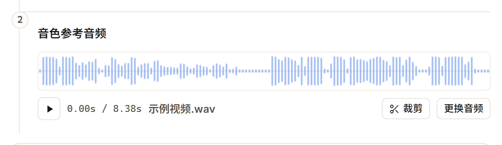

### 0.3 一分钟版本

1. 双击 `start_server.bat`，浏览器自动打开 `http://127.0.0.1:7860`。
2. 左边输入文字 → 在「音色参考音频」里拖入一段 **3~10 秒、干净的人声**（也可以直接拖视频，见 0.2）。
3. （可选）展开「情感控制」选一种情绪来源；展开「术语读音」纠正专业词。
4. 点「生成语音」。第一次要加载模型，约 20~60 秒；之后常驻显存。
5. 结果区试听 → 需要的话拖动波形裁剪、调音量 / 变速 → 下载 WAV / MP3，或「保存到目录」。
6. 常用配置可以 `Ctrl+S` 存成预设，下次一键回填。

停止服务：双击 `stop_server.bat`。

---

## 1. 安装与启动

### 1.1 用整合包（普通用户推荐）

- 解压后双击 `start_server.bat`。脚本会先结束 7860 端口上的旧实例，再启动服务并自动打开浏览器。
- 换端口：`start_server.bat 7861`，然后在浏览器打开对应地址。
- 停止：`stop_server.bat`（也可带端口号）。
- 注意：启动脚本会**强制结束占用该端口的进程**，不要把别的服务放在 7860 上。

### 1.2 从源码运行（开发者）

```bash
uv sync --extra server
uv run --extra server python server.py
```

要求：Windows 10/11、NVIDIA 显卡（没有 N 卡会自动降级为纯 CPU，速度极慢，不推荐）、[Visual C++ 2015–2022 运行库 x64](https://aka.ms/vs/17/release/vc_redist.x64.exe)、
`git`、`uv`（Python 3.10–3.11 由 uv 管理）。模型权重放在 `checkpoints/`，缺权重时首次生成会报错。

### 1.3 日志在哪

| 文件 | 内容 |
|---|---|
| `logs/server.log` | 应用日志：加载、生成、报错原因（排查优先看这个） |
| `logs/server_bg.log` | 启动脚本捕获的控制台输出（服务没起来时看这个） |

控制台里的中文可能因系统编码显示成乱码，**以日志文件为准**，不影响运行。

---

## 2. 界面总览

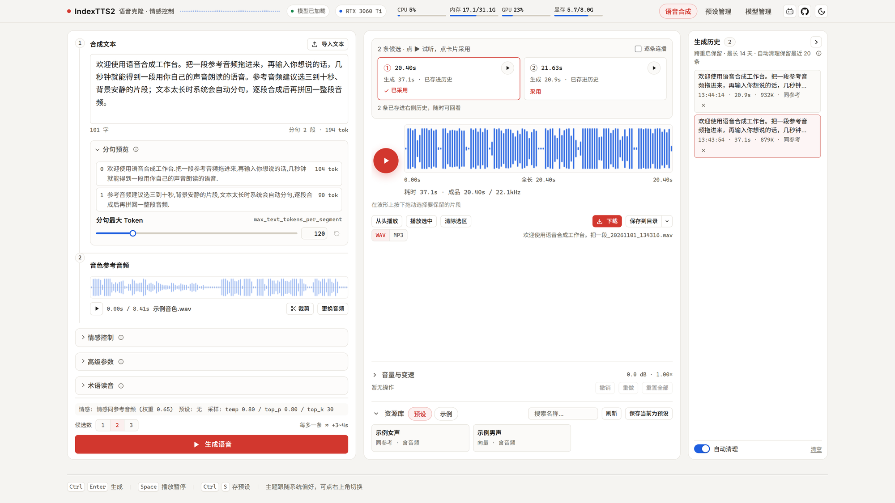

顶栏：模型状态、显卡型号、CPU / 内存 / GPU / 显存四条仪表，右侧是三个页面和主题切换。

| 页面 | 用来做什么 |
|---|---|
| 语音合成 | 日常主界面：文字 + 参考音频 → 音频，并完成剪辑与导出 |
| 预设管理 | 把「音色 + 情感 + 参数」存成命名预设，下次一键回填 |
| 模型管理 | 加载 / 卸载 / 重启模型，调精度、速度、显存相关选项 |

快捷键：

| 键 | 作用 |
|---|---|
| `Ctrl + Enter` | 生成语音 |
| `Ctrl + S` | 把当前状态保存为预设 |
| `Space` | 播放 / 暂停当前结果 |
| `Ctrl + Z` / `Ctrl + Shift + Z` | 剪辑台撤销 / 重做 |
| `Esc` | 关闭弹窗 |

---

## 3. 语音合成页

### 3.1 输入文本

- 直接输入或粘贴；右上角「导入文本」可读 `.txt` / `.md`（也支持把文件拖进文本框）。
- 编码自动识别 UTF-8 / UTF-16 / GB18030；二进制文件、超过 2 MB 的文件会被拒绝。
- 导入会替换框内现有内容，导入后按 `Ctrl+Z` 可撤回。
- 字数上限 **10000 字**（硬性）；超过 **2000 字** 只会提醒“会很慢”，不拦。
- 「分句预览」会实时显示这段文字会被切成几段、每段多少 token，并估算耗时。
- 「分句最大 Token」默认 120：调大 → 段数更少、单段更长；调小 → 段数更多、更稳但更慢。


> 长文稿建议拆成几段分别生成再拼接，比一次跑几千字更可控。

> **英文撇号缩写（`don't`、`they're`、`can't`）读不出原本的连读音。**
>
> 这是模型词表的限制，不是操作问题：当前模型的英文词表里**没有**任何缩写的整词写法，
> `don't` 会被拆成 `don` + `'` + `t` 三段逐段念，所以听起来像"冬特"或者直接把字母念出来。
>
> **只有这 4 个缩写有同音整词，可以直接换成整词，读出来和原音一致：**
>
> | 想写 | 换成 | 说明 |
> |---|---|---|
> | `they're` | `their` | 同音，换成 `their` 就念成 they're 的味道 |
> | `you're` | `your` | 同音 |
> | `it's` | `its` | 同音（`it's` 本身已被自动展开成 `it is`，不会念字母，但不是缩写读法） |
> | `we'll` | `well` | 同音，直接写 `well` |
>
> **其余常见缩写（`don't` `can't` `won't` `isn't` `aren't` `didn't` `that's` `she's` `he's`
> `I've` `I'd` `let's` `o'clock`）没有同音整词可换**，只能写成完整形式
> （`do not` / `cannot` / `will not` / `is not` / `they are` / `let us`…）。
> 这样读得清楚，但会比真人一字一顿。
>
> 两个额外坑：
> - 从 Word / 微信粘进来的稿子是**弯撇号** `’`，术语表匹配不到，先全文替换成半角 `'`。
> - 所有格 `the rabbit's fur` 会被读成 "the rabbit **is** fur"（`it`/`he`/`she`/`that` 等结尾的词
>   撞上了缩写规则）。稳妥写法是改成 of 结构：`the fur of the rabbit`。
>
> 要彻底解决需要换 IndexTTS-2.5（官方支持英文音标标注）；本整合包是 2.0，只能按上面的写法规避。

### 3.2 音色参考音频

- 支持格式、大小上限、ffmpeg 前提见 **0.2**；同一个上传框也能直接选视频并自动抽音轨。
- 选了不支持的格式、体积超限，或视频抽音轨 / wma 转码失败时，界面会说明原因，并**自动退回上一份可用的参考音频**——不会出现“界面显示已选中、生成时却用不了”的状态。
- **3~10 秒、单人、无背景音乐、无混响**的干净人声效果最好；同语言、同口音更稳。
- 服务端只使用参考音频的 **前 15 秒**，更长的部分不参与克隆；界面会提示。
- 点「裁剪」可拖选想要的片段（默认选前 15 秒）；推荐落在 3~15 秒。
- 裁剪弹窗底部可直接下载：「下载完整」拿当前参考音频的原文件，「下载选区」把框中的一段存成 WAV（文件名与「设为参考音频」得到的一致）。选区为空或就是整段时，「下载选区」不可用。
- 从视频抽出的音轨就是普通参考音频：播放、裁剪、生成、下载都照旧；要保存它，点「裁剪」→「下载完整」。
- 参考音频里的情绪也会被带进结果——这就是默认的「情感模式 0」。


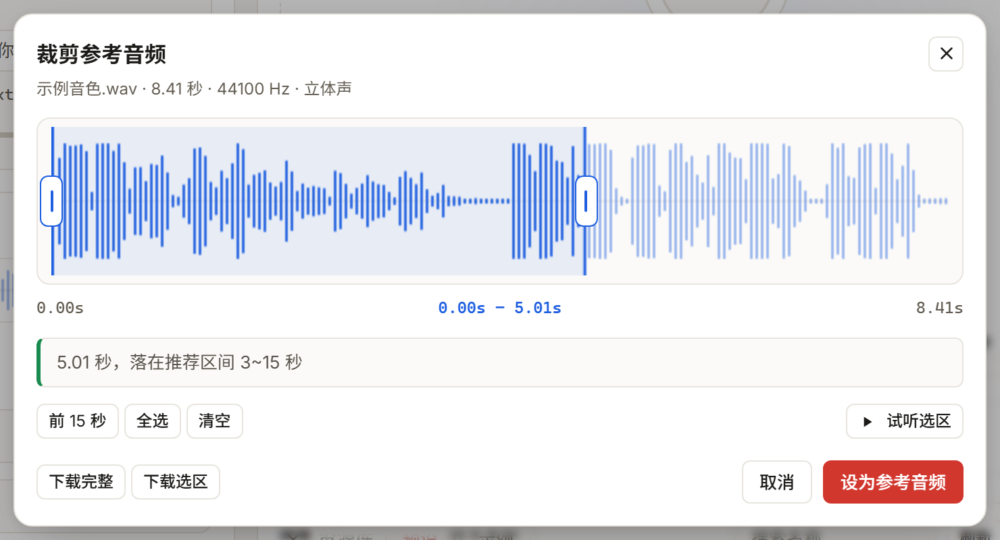

### 3.3 情感控制：四种模式怎么选

| 模式 | 情绪从哪来 | 要准备什么 | 适用场景 |
|---|---|---|---|
| 0 · 与音色参考音频相同 | 音色参考音频本身的情绪 | 只要音色音频 | 默认、最省事；参考音频什么情绪，结果就什么情绪 |
| 1 · 使用情感参考音频 | 另一段音频的情绪 | 再上传一段表达目标情绪的音频 | 音色和情绪要分开控制：用 A 的声音，说 B 的语气 |
| 2 · 使用情感向量控制 | 8 个滑块（喜/怒/哀/惧/厌恶/低落/惊喜/平静） | 不用音频，拖滑块 | 想精确控制情绪配比，手头没有合适的情感音频 |
| 3 · 使用情感描述文本（实验） | 一句话描述，交给 Qwen 分析 | 填一段描述（≤500 字） | 想用自然语言描述情绪；结果不稳定，且首次使用会多占显存、多等几秒 |

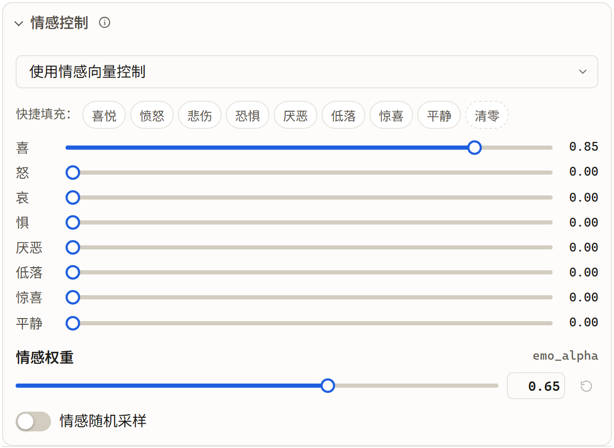

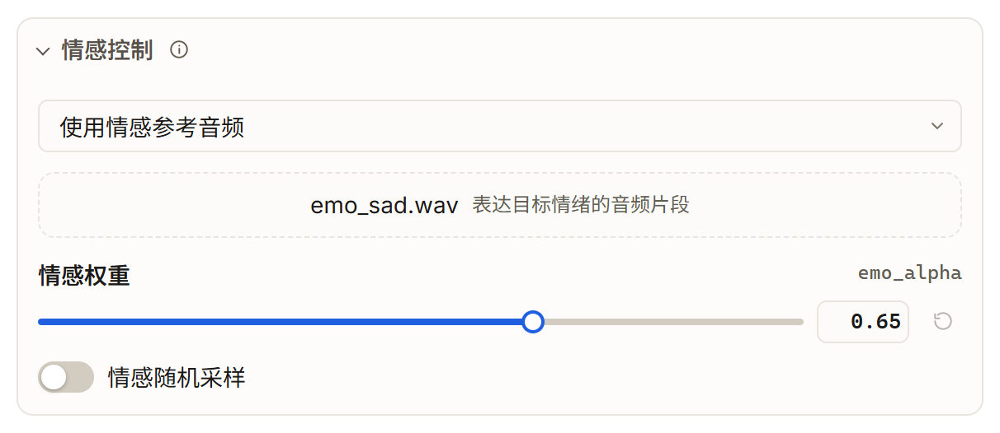

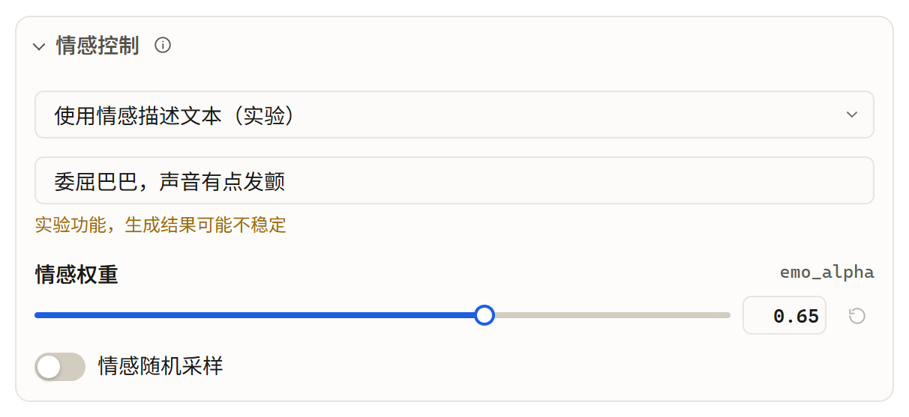

**共同的坑（代码行为，界面不一定明说）：**

- **「情感权重」只在模式 1 有效。** 模式 0 / 2 / 3 下服务端会把权重强制为 1.0，
  调滑块不会有任何变化。
- **「情感随机采样」只在模式 2（向量）有效。** 它决定 8 维情绪原型是“随机挑”还是
  “挑和参考音色最接近的”，其它模式勾不勾都一样。
- 模式 1 必须真的上传情感音频，否则服务端直接报错，不会偷偷回退成模式 0。
- 情感音频和音色音频用的是同一个上传器：同样支持五种基础格式、单个 ≤ 32 MB；服务端有 ffmpeg 时也能选 m4a / aac / wma 或视频（自动抽前 10 分钟音轨）。
- 模式 3 的描述文本不是提示词，而是送给情绪分类模型做分析；写“愤怒地朗读”这类描述即可，
  不用写完整句子。
- 8 维向量的每一维 0~1，系统会做偏置并把总和压到 0.8 以内，防止情绪过载；
  拿不准就先点一个快捷情绪（0.85），再微调。

### 3.4 高级参数

| 参数 | 默认 | 调大 / 打开会怎样 | 什么时候动 |
|---|---|---|---|
| 采样模式 `do_sample` | 开 | 开：每次结果略有不同，更自然；关：更稳定但更“平” | 想复现同一结果时关闭 |
| 温度 `temperature` | 0.80 | 越大越发散、情绪更丰富，也更容易读错；越小越稳 | 声音太呆板可略调高，读错多则调低 |
| 核采样 `top_p` | 0.80 | 越小候选越少、越保守 | 一般不动 |
| 候选数 `top_k` | 30 | 越小越保守；0 表示关闭该过滤 | 一般不动 |
| 束宽 `num_beams` | 3 | 越大质量略好，但更慢、更吃显存 | 8G 卡建议 2~3，不要盲目拉高 |
| 单段长度上限 `max_mel_tokens` | 1500 | 越大越不容易“结尾被截”，上限 1815 | 出现“结尾被截断”提示时调高 |
| 重复惩罚 `repetition_penalty` | 10 | 越大越抑制重复；**低于 1 会一直生成到撞上限** | 出现复读可小幅调高 |
| 长度惩罚 `length_penalty` | 0 | 正值倾向更长、负值倾向更短 | 仅束搜索时明显 |
| 段间停顿 `interval_silence` | 200 ms | 多段文本之间的静音长度 | 有声书 / 旁白需要呼吸感时调大 |

补充：

- **参数锁**：锁定后，应用预设、刷新页面都不会改这些数值。适合“音色和参数已经调好，只换文字”。
- 数值超出范围不会报错，会被夹到边界；界面会在生成前提示改了哪几项。
- 耗时大头是声学合成（扩散）；想更快优先调「扩散步数」和「CFG 强度」（见第 5 节），
  比调采样参数有效得多。

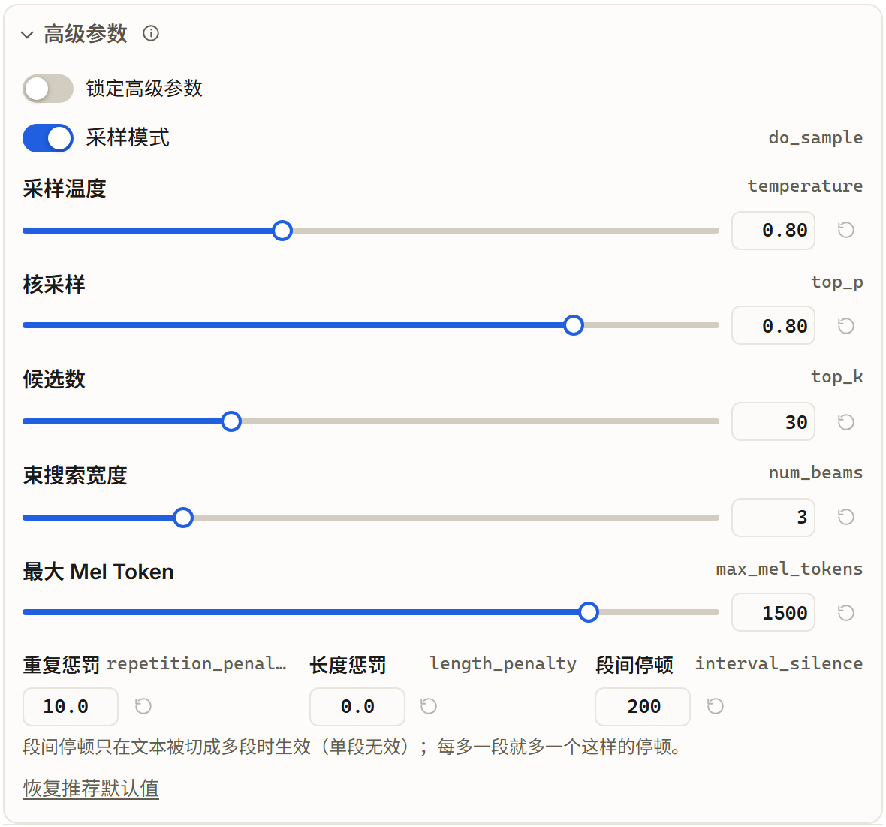

### 3.5 术语读音：怎么用

适合纠正 `IndexTTS2`、`CAMPPlus`、`C++`、`M.2`、多音字、公司名这类“模型容易读错”的词。

**操作步骤**

1. 展开「术语读音」。
2. 填「术语」——必须是文本里**原样出现**的那串字符（如 `IndexTTS2`）。
3. 填「中文读法」（写**同音汉字**）和 / 或「英文读法」——你希望它被念成什么。
4. 点「添加」；生成时自动替换。术语保存在 `checkpoints/glossary.yaml`，重启仍有效。

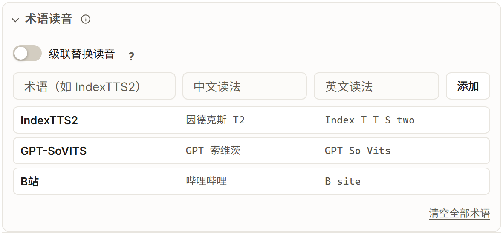

**两种读法什么时候用**

- 文本里**只要有中文**，就按「中文读法」替换；
- 文本是**纯英文**（不含汉字），才按「英文读法」替换；
- 只填了一种？另一种语言下这条术语**不生效**（按原样读）。中英混排的稿子建议两列都填。

**格式建议**

| 术语 | 中文读法 | 英文读法 | 效果 |
|---|---|---|---|
| `IndexTTS2` | `Index T T S 二` | `Index T T S two` | 避免被连读成一个怪词 |
| `C++` | `C 加加` | `C plus plus` | |
| `M.2` | `M 二` | `M dot two` | |
| `银行`（多音字） | `银杭` | — | 用同音汉字把默认读音换掉 |

> **中文读法必须填汉字，不能填拼音。** 术语表是在送进模型前做**文本替换**，
> 填 `yín háng` 或 `yin2 hang2` 都不会被当作拼音去读——替换进去的是一串拉丁字母，读出来不是你要的音。
> 多音字就找同音字替换：`银行 → 银杭`、`重庆 → 虫庆`、`行长 → 航长`。
> 「英文读法」列填的是英文拼写（如 `Index T T S two`），只对纯英文句子生效。

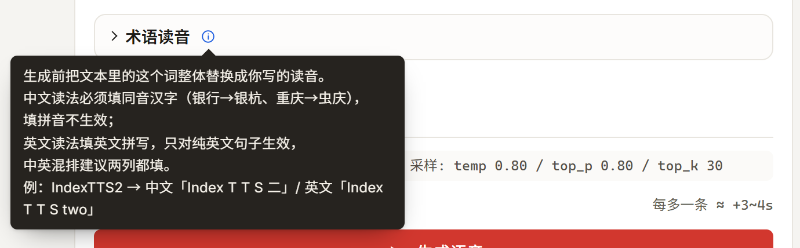

**匹配规则**

- 英文 / ASCII 术语**不区分大小写**，但要求“整词”匹配：`TTS` 不会命中 `ATTS`，
  `C` 不会命中 `C++`。
- 中文术语不要求词边界，`人工智能` 也能命中 `人工智能技术`。
- 多条术语同时命中时，**按术语长度从长到短**替换（你控制不了先后）。

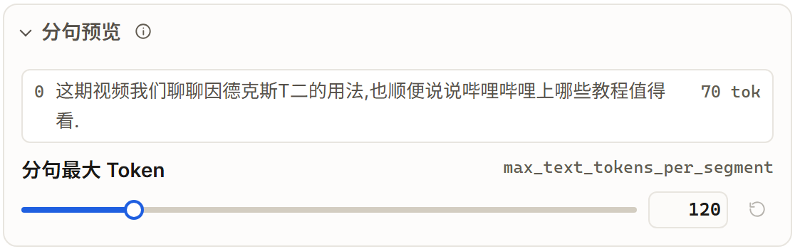

**「级联替换」是什么**

- 关闭（默认）：每条术语只改**原文**，替换出来的读音不会再被别的术语改。
  例：既有 `C++ → C 加加` 又有 `C → 西`，输入 `C++` 会得到 `C 加加`。
- 打开：替换结果留在文本里，后面的术语会继续改写它。适合把读音拆成多条组合，
  例如 `集团 → 控股`、`控股 → 母公司`，最终得到 `母公司`。
  但顺序按长度固定，容易出现你没想到的连锁，非必要不开。

**加了却不生效，按顺序查**

1. 文本语言是否和填的那一列对应（中文稿 → 看中文读法）；
2. 术语是否和原文完全一致（空格、连字符、大小写不影响英文，但空格要一致）；
3. 是否开了级联导致被二次改写；
4. 结果区是否出现「文本规范化异常」提示——规范化退化时读音会回退，完整原因在
   `logs/server.log`。

### 3.6 生成、候选与中断

- 点「生成语音」（或 `Ctrl+Enter`）。首次会先加载模型，五步进度：
  模型加载 → 参考特征 → GPT 生成 → 声学合成 → 声码解码。


- **候选数 1 / 2 / 3**：同一段文本串行生成多条，方便挑最像的。
  每多一条就多跑一遍完整推理，耗时约等于单条生成时间；显存峰值与单条相同。
  候选数不记忆，刷新回 1。
- 长文本（单条预计约 10 分钟以上）选多条候选时，生成前会先确认：5 秒内不操作
  或点「调整为 1 条」都会自动折回 1 条，点「保持 N 条」则按原选择继续。
- 多候选时点卡片上的 ▶ 试听，可勾「逐条连播」做 A/B；点卡片或按 `Enter` 采用。
  某条失败只标红那一张，可「重试这条」；停止只中止当前条，已完成的保留。
- 生成中可以「停止」：只在阶段边界停止，不会留下半截文件；模型保持加载。
- 不小心关了页面？重新打开会自动找回本标签页的任务（同一浏览器标签页）。
- 多个任务会排队，同一时刻只跑一个推理。


### 3.7 结果区：试听、剪辑、导出


**试听与裁剪**

- 在波形上**按住拖动** = 选出要保留的片段；「播放选中」只播这一段，「清除选区」取消。
- 「下载」拿到的是**未经剪辑**的源文件。

**音量与变速**（默认折叠）

- 音量：-24 ~ +24 dB。右侧显示峰值 dBFS；会削波时出现「削波处理」，一键拉到不失真的最大增益。
- 变速：0.5 ~ 2.0×，保音高（不会变成“快放花栗鼠”）。常用倍率有快捷按钮。
- 有音量 / 变速操作时会出现「编辑结果」，试听和下载都基于它；可撤销 50 步。
- 只裁剪不加音量 / 变速时，直接下载裁剪结果即可（文件名带 `_trim`）。

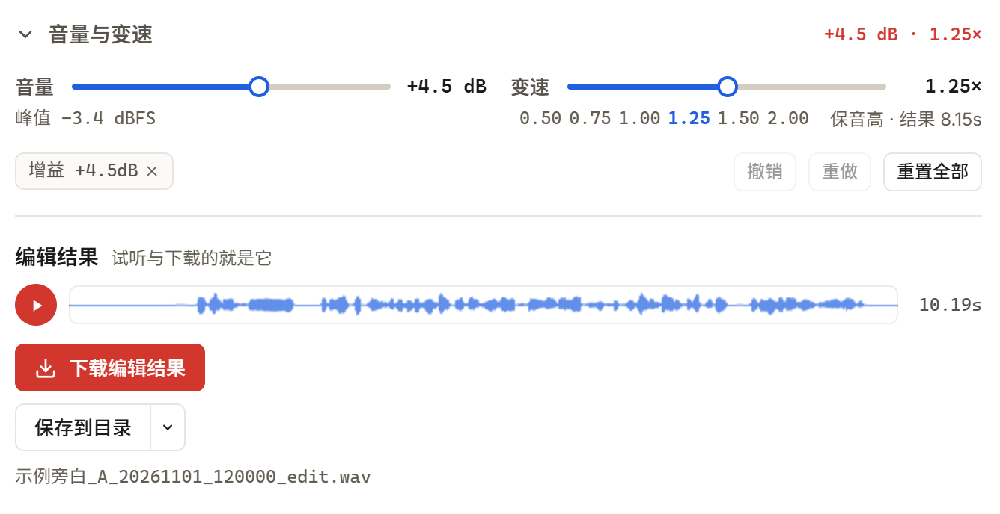

**导出格式 WAV / MP3**

- 默认 WAV；MP3 为 160 kbps，在**浏览器里**编码，不占显卡、不需要 ffmpeg。
- 格式开关同时作用于「下载源音频」「下载编辑结果」「保存到目录」。
- MP3 按钮变灰：编码组件没加载成功（刷新页面或检查 `web/lame-1.2.1.min.js` 是否存在）。

**保存到目录（可选）**

- 「下载」走浏览器；「保存到目录」是把文件写到**运行服务的那台电脑**上的指定文件夹，
  所以手机 / 局域网其它设备也能用，但文件不在访客自己的电脑上。
- 第一次使用会弹文件夹选择；也可以手动输入路径（相对路径按服务所在目录解析）。
- 同名不覆盖，自动变成 `xxx (1).wav`。
- 保存失败（目录被删、没权限、磁盘满）会自动退回一次浏览器下载，音频不会丢。
- 远程访问时**不能改目录**（403），但可以在主机已设好的目录里保存。


### 3.8 生成历史（右栏）


- 保留最近 **20 条**，重启服务后仍在（`data/history.json`）。
- 音频文件受 `outputs/` 的 **14 天**清理策略约束：超过 14 天的记录文件会被删，
  记录本身也会在载入时被丢弃。
- 点条目可重新载入试听 / 再剪辑；「自动清理」决定被挤出历史的旧 wav 要不要一起删。

### 3.9 资源库（预设 / 示例）

- 「保存当前为预设」（或 `Ctrl+S`）：把当前文本以外的音色、情感、参数存下来，
  参考音频 / 情感音频会一起存进 `outputs/presets/`。
- 「应用」把预设回填到合成页；参数被锁定的项不会被覆盖。
- 「示例」是内置的几条现成组合，点一下就能试听不同音色，适合先感受效果。


---

## 4. 预设管理页

三栏：左边筛选，中间卡片，右边详情 / 新建。

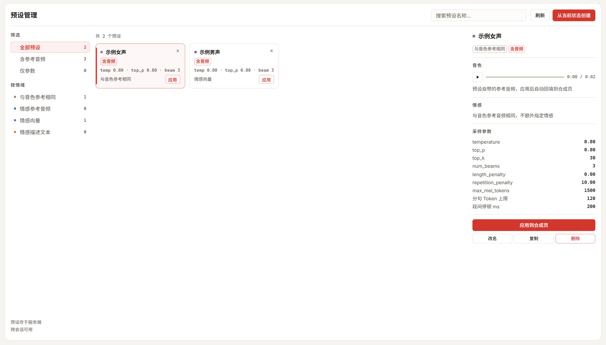

- 卡片上的「应用」一步回填并回到合成页；点卡片本身只选中，在右栏看详情。
- `改` 改名、`复` 复制、`×` 删除（删除不可恢复）。
- 可按「是否含音频」「情绪模式」过滤，计数实时显示。
- 应用预设时，**被锁定的参数保持当前值**，不会被预设覆盖。

---

## 5. 模型管理页

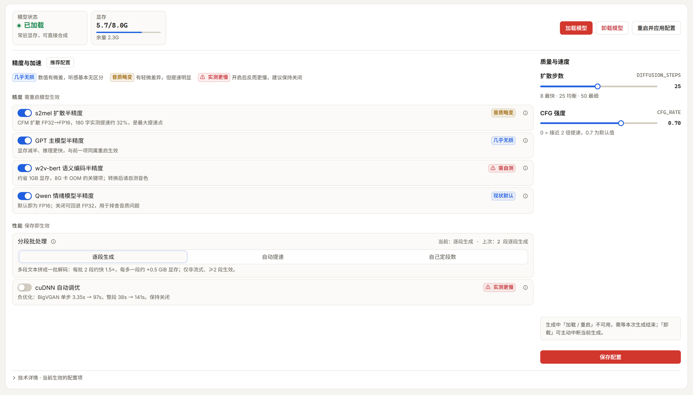

### 5.1 模型生命周期

- 模型是**懒加载**的：第一次生成才加载（约 20~60 秒），之后常驻显存。
- 「加载」「重启并应用配置」在生成中不可用；「卸载」可用，会先中断当前生成再释放显存。
- 重启会先释放旧实例再加载新实例，避免新旧模型同时占显存。

### 5.2 精度开关（改了要重启模型）

| 开关 | 影响 | 建议 |
|---|---|---|
| GPT 主模型 FP16 | 显存减半、更快，几乎无损 | 默认开 |
| s2mel 扩散 FP16 | 长文本提速约三成，音色可能轻微变化 | 默认开；不满意音色可关掉对比 |
| w2v 语义编码 FP16 | 省约 1 GB 显存，8G 卡抗 OOM 的关键 | 默认开；开启后请自测音色 |
| Qwen 情绪 FP16 | 情绪描述模型半精度 | 默认开；只在排查模式 3 问题时关 |

「cuDNN 自动调优」在本模型上是**负优化**（实测明显变慢），保持关闭。

### 5.3 质量与速度（保存后下一次生成生效）

- **扩散步数** 1~50，默认 25：8 最快、25 均衡、50 最细。降到 10~16 能明显提速，音质略变。
- **CFG 强度** 0~1，默认 0.70：越接近 0 越快（0 约再快一倍），但对参考音频的风格跟随会变弱。
- 这两项和下面的批处理档位**不需要重启模型**。

### 5.4 分段批处理（进阶）

把多段文本的 GPT 解码拼成一个 batch，减少重复开销。**只在“非流式 + 文本切成 ≥2 段”时生效**，
单段文本零收益。三种档位从左到右排列，同一时间只能选一种：

**① 逐段生成（默认，0）**：不拼批，显存最省，输出与旧版一致。右侧「本机实际」显示「当前：逐段生成」。


**② 自动提速（-1）**：按当前空闲显存决定每批几段，尽量吃满显卡。右侧会直接告诉你**本机当前能拼几行、预算多少**——截图里这台 8 GB 卡是「≈ 3 行（预算 1.71 GiB）」，换机器 / 模型加载前后数字会变。显存不够时自动退回逐段执行，不会硬拼。


**③ 自己定段数（2~12）**：选中后展开行数滑轨，固定每批段数。右侧会同时给出「本机可拼 X 行」；填得超过本机预算会被压到实际行数，并在生成后说明是「被压到」而不是按你的值跑。


生成结束后，「本机实际」还会追加**上一次真正怎么跑的**：`上次：6 段 → 2 批` 或 `上次：显存不足，退回逐段`，退档原因不会被数字挤掉。8G 卡想提速：显存空闲多时开两段一批（实测快约 1.4 倍），桌面程序占得多时先用默认，改调扩散步数 / CFG 更稳。

**实测收益（500 字，8~9 段）**：逐段生成 **RTF 0.89**，两段一批 **RTF 0.64**（用时 93.5 → 67.7 秒，快约 1.4 倍），代价是全卡显存峰值从 6.0 GB 升到 7.8 GB（含系统约 0.7 GB）。三轮明细见 5.6。

### 5.5 保存与生效关系

- 「保存配置」写进 `model_config.json`，重启服务后仍然有效；
- 精度开关：**需要重启模型**才生效；
- 扩散步数 / CFG / 批处理：**下一次生成**就生效；
- 保存的文件会覆盖启动脚本里同名的默认值，想回默认就删掉 `model_config.json` 或改回界面值。

### 5.6 实测耗时（500 字长文）

本机（RTX 3060 Ti 8 GB，25 步扩散 / CFG 0.7 / fp16 全开）跑三段不同主题的 479~506 字中文，模型已加载（不含首次加载）：

| 配置 | 平均生成耗时 | 平均音频时长 | RTF | 显存峰值 |
|---|---|---|---|---|
| 逐段生成（默认） | 93.5 秒 | 105.6 秒 | **0.89** | 6.03 GB |
| 两段一批 | 67.7 秒 | 105.8 秒 | **0.64** | 7.80 GB |

显存峰值为 `nvidia-smi` 报告的全卡占用，含系统与桌面约 0.7 GB；模型生成本身约占 5.3 GB（逐段）/ 7.1 GB（两段一批）。

> **RTF = 生成耗时 ÷ 音频时长**，0.89 表示 100 秒的音频约 89 秒生成完，**小于 1 就是比实时快**。逐段生成已经跟得上真人语速；赶时间再把批处理开到 2 行，约快 1.4 倍。

两点边界：批处理只对切成 ≥2 段的文本有效，短句单段不会变快；两段一批时峰值 7.8 GB，8 GB 卡只剩约 0.4 GB 余量，桌面程序占用多时可能爆显存，这时退回逐段生成更稳。三轮逐条 RTF：逐段 0.86 / 0.89 / 0.91，两段一批 0.68 / 0.64 / 0.59。

---

## 6. 常见工作流

### 6.1 试音色（先听再决定）

资源库 → 示例 → 点一条 → 直接生成。满意后再换成自己的参考音频。

### 6.2 做有声书 / 长旁白

导入稿子 → 分句预览确认切法 → 「分句最大 Token」调到 150~250 减少段数 →
「段间停顿」调到 300~500 ms → 长文分段生成 → 用候选数 2 挑更稳的一条。

### 6.3 角色对白（音色和情绪分开）

用角色 A 的音频做音色 → 情感模式 1 → 上传情绪参考音频 → 权重 0.6~0.8 →
存成预设；换角色时应用对应预设。

### 6.4 专业词很多的稿子

先把所有容易读错的词加进术语表（中英两列都填）→ 生成前看分句预览里的规范化文本 →
结果区若提示规范化异常，去 `logs/server.log` 看原因。

### 6.5 批量比稿

候选数选 3 → 生成 3 条 → 勾「逐条连播」对比 → 点卡片采用最满意的一条 →
在波形上粗剪 → 导出 MP3 发人。

---

## 7. 命令行与 AI 助手（进阶，可选）

不想开网页也能用：

- **命令行 `indextts2`**：不启动 Web 服务，自己加载模型出音频。子命令：
  `init`（初始化配置与模型目录）、`config`、`download`（下载权重）、`check`（检查设备）、
  `synth`（单条合成）、`batch`（JSON Lines 批量）、`concat`（拼接 wav）。
  完整参数运行 `indextts2 --help` 或 `indextts2 <子命令> --help` 查看。
- **Agent Skill `skills/indextts2-tts/`**：装到支持 Skill 的 AI 助手后，可以直接说
  “用这个音色把这段稿子念出来”。它走 HTTP，提供 25 个子命令（探活 / 模型加载卸载 / 音色 / 合成 /
  变速 / 批量 / 术语读音），但不包含网页里的剪辑台、波形选区与「保存到目录」。

两者都不提供网页里的剪辑台与保存到目录；**模型页的「分段批处理」档位和「保存到目录」设置只能在网页里改**
（Skill 的 `batch` 是排队跑多条独立合成，不是模型页那个把多段文本拼成一个 GPU batch 的开关）。
区别在于：Agent Skill 走 HTTP，和网页共用同一把推理锁，任务会排队；
`indextts2` 命令行是自己加载一份模型，不要和网页同时跑，否则显存会翻倍。

---

## 8. 常见问题（FAQ）

### 8.1 安装 / 启动

**Q：双击 `start_server.bat` 一闪而过，浏览器也没打开。**
用命令行在该目录运行 `start_server.bat`，或者直接看 `logs/server_bg.log` 的最后几行——
通常是缺少运行库、缺模型文件或端口被占用。服务最多等 120 秒，超时会明确报错。

**Q：报 `_kaldifst` 的「DLL 初始化例程失败」/ `torchaudio.pyd` 的「找不到指定的模块」/ `VCRUNTIME140.dll` 缺失。**
缺 **Visual C++ 2015–2022 运行库（x64）**。安装一下 VC++ 运行库 x64：
https://aka.ms/vs/17/release/vc_redist.x64.exe 装完重启电脑，再启动服务。
不要用 `pip` 重装 torch 来“修”，那会破坏锁定的版本对应关系。

**Q：报 `ModuleNotFoundError: No module named 'xxx'`。**
依赖没装全。源码运行请重新 `uv sync --extra server`；整合包用户说明包不完整，重新解压完整包。

**Q：`uv` 不是内部或外部命令。**
源码运行需要先装 uv；普通用户直接用整合包即可，不需要 uv。

**Q：端口 7860 被占用 / 启动失败。**
`stop_server.bat` 先停；仍不行就换端口 `start_server.bat 7861`。
注意启动脚本会结束占用该端口的任何进程。

**Q：浏览器打开是空白页 / 旧界面。**
先 `Ctrl+F5` 强制刷新。升级后资源带版本指纹，通常刷新即可；仍空白看 `logs/server.log`。

**Q：页面能开，但仪表显示 `--`。**
没读到 NVIDIA 显卡信息（不是 N 卡、驱动太旧、或服务启动时驱动未就绪）。
15 秒后会自动重试；**只影响显示，不影响推理**。

**Q：模型放哪？下载很慢怎么办。**
放 `checkpoints/`（需 `gpt.pth`、`s2mel.pth`、`bpe.model`、`config.yaml`、`qwen0.6bemo4-merge/` 等）。
国内可用 `HF_ENDPOINT=https://hf-mirror.com`（启动脚本已默认设置）或走 ModelScope。

### 8.2 显卡 / 显存

**Q：`CUDA out of memory`（显存不足）。**
按顺序做：确认 w2v / GPT / s2mel 的 FP16 都开着 → 扩散步数降到 10~16 → CFG 调到 0~0.5 →
候选数回到 1 → 分段批处理选「逐段生成」→ 关掉游戏 / 浏览器硬件加速 / 其它占显存的程序。
8G 卡不要同时开多个候选。

**Q：`CUDA driver version is insufficient` / `no CUDA-capable device is detected`。**
更新 NVIDIA 驱动；确认是 NVIDIA 独显且没被禁用；笔记本请确认服务跑在独显上。

**Q：`Torch not compiled with CUDA enabled`。**
装成了 CPU 版 torch。按仓库的 `uv.lock` 重新同步依赖，不要手动 `pip install torch`。

**Q：没有显卡能跑吗？**
能跑，但很慢：没有检测到 NVIDIA 显卡时，程序会自动降级为纯 CPU 推理，内存占用较大、生成速度极慢，只适合验证功能，不适合日常使用。

### 8.3 声音效果

**Q：支持哪些参考音频 / 视频格式？**
基础五种是 wav / mp3 / flac / ogg / opus，单个 ≤ 32 MB。服务端检测到 ffmpeg 后，会额外接受 m4a / aac / wma（自动转 WAV），并在上传框里显示视频入口（mp4 / mov / m4v / mkv / webm / avi / flv，≤ 200 MB，只取前 10 分钟音轨）。没有 ffmpeg 时基础五种照常可用，其余格式会在选文件 / 拖入时被拦下。

**Q：选了 wma / 视频，提示转换失败？**
先确认服务端有 ffmpeg：上传框的「可选格式」会随检测结果变化，能选到 m4a / 视频就说明已经识别到（把 `ffmpeg.exe` 放进 `tools\ffmpeg\bin\` 或系统 PATH 后重启服务）。若转换报「视频里没有音轨」，说明该文件是静音录屏或封装里没有音频流；报「已损坏或不是完整的音视频文件」则换一个文件。转换失败时界面会退回上一份可用的参考音频，不会影响已经选好的音色。

**Q：音色不像。**
参考音频最好 3~10 秒、干净、单人、无 BGM；太短（<3 秒）或带混响都不稳。
另外检查：s2mel FP16 是否让音色变了（可关掉对比）、扩散步数是否太低、CFG 是否接近 0。

**Q：调「情感权重」没反应。**
只有**情感模式 1**（情感参考音频）使用这个权重；模式 0 / 2 / 3 下它是被忽略的。

**Q：勾「情感随机采样」没变化。**
它只在**情感模式 2（向量）** 下生效。

**Q：结尾被截断 / 少念了最后一句。**
单段音频撞到了 `max_mel_tokens`。把「单段长度上限」调高（最多 1815），或把「分句最大 Token」调小，
让每段更短。结果区出现「结尾被截断」提示时就是这件事。

**Q：声音有电音 / 忽快忽慢。**
变速功能是保音高的，但极端倍率（<0.75× 或 >1.6×）会有人工感，先回到 1.00× 对比。
原声本身有电音则多半是参考音频质量或步数太低。

**Q：数字、英文、多音字读错。**
优先用「术语读音」改正——中文读法写**同音汉字**（`银行 → 银杭`、`重庆 → 虫庆`），
写拼音不生效；长串数字/单位可以先在文本里改写成你想要的读法。

**Q：中文里夹英文，英文词读得很怪。**
在术语表里给这个词同时填中文读法和英文读法——中文句子只会用中文读法那一列。

**Q：英文缩写 `don't`、`they're` 读成"冬特 / 逐字母"，怎么调都不对。**
调不出来，这是模型词表的限制：2.0 的英文词表里没有缩写的整词写法。
只有 `they're→their`、`you're→your`、`it's→its`、`we'll→well` 这四个能换成同音整词读出原音，
其余缩写只能写成完整形式（`do not`、`cannot`、`they are`…）。详见 **3.1** 的英文缩写说明。

**Q：长文本很慢。**
耗时大头是声学合成（扩散）。优先降扩散步数、降 CFG；其次用分段批处理；再其次把稿子分段。
文本超过 2000 字会提示“期间独占 GPU”，这是正常的。

**Q：关掉网页会停止生成吗？**
不会，生成在服务端继续。重新打开同一标签页会自动找回任务；换标签页则视为新任务。

### 8.4 术语读音

**Q：加了术语但读法没变。**
按 3.5 节末尾的四步排查：语言列对不对、是否原样匹配、是否被级联二次改写、是否规范化退化。

**Q：同一个术语再添加一次会怎样？**
按列合并：只填中文就只更新中文列，英文列保留原值；两列都填就都更新。界面提示会写明沿用了哪一列。

**Q：清空术语会影响已经生成的历史吗？**
不会，历史音频已经生成完毕；只影响之后的生成。

### 8.5 导出与保存

**Q：MP3 按钮是灰的。**
浏览器里负责编码的组件没加载成功。刷新页面；仍不行就先用 WAV。

**Q：保存到目录报 403。**
你在别的设备 / 局域网上访问，改目录和打开目录只允许服务所在电脑操作；
让主机先设好目录，访客可以直接往里保存。

**Q：保存到目录报 409。**
目录已不存在 / 变成了文件 / 同名冲突到 9999 个。重新选目录或换文件名。

**Q：保存到目录报 501。**
本机缺少图形选择框组件，手动输入路径即可。

**Q：保存到目录报 507。**
磁盘满了。清理目录后重试；失败时系统会自动退回浏览器下载。

**Q：文件名被改了。**
Windows 非法字符会被替换，过长文件名会自动截短；同名自动加 `(1)`、`(2)`，不会覆盖已有文件。

### 8.6 数据与安全

**Q：重启后历史 / 预设还在吗？**
在。历史在 `data/history.json`（最近 20 条），预设在 `outputs/presets/`，术语在
`checkpoints/glossary.yaml`，模型配置在 `model_config.json`。

**Q：生成的文件在哪？**
`outputs/`（14 天后自动清理）、预设目录 `outputs/presets/`、你自己设置的保存目录。

**Q：怎么备份 / 换电脑？**
停服务后整个文件夹拷走即可；换机器把 `checkpoints/` 一并带上。

**Q：能让局域网其它设备访问吗？**
可以但**不推荐**：用 `--host 0.0.0.0` 启动，而接口没有登录鉴权，还包含删除文件的能力。
只在完全可信的网络里这么做。

**Q：装了「长篇台本」扩展会不会冲突？**
不会。扩展走独立的 `/api/v1/lf/*` 路由和独立页面，和本指南描述的页面互不影响。
如果整包覆盖升级，覆盖后重跑一次扩展的 `install.py` 即可补回入口。

---

## 9. 术语小抄

| 词 | 白话解释 |
|---|---|
| 参考音频 / 音色音频 | 给模型“听”的一段人声，决定新声音像谁 |
| 情感参考音频 | 第二段人声，只借它的情绪，不借音色 |
| 情感权重 `emo_alpha` | 模式 1 下情绪像参考音频的程度，0~1 |
| 采样 / 温度 / top_p / top_k | 控制“生成时有多随机”，越大越活、越小越稳 |
| 束搜索 `num_beams` | 同时保留几条候选路径再挑最好的，越大越慢 |
| 重复惩罚 | 抑制复读的力度，低于 1 会失控 |
| 分句 Token | 一段最多多少个文字 token，决定切多碎 |
| 扩散步数 | 声学合成的精细度，步数越多越细也越慢 |
| CFG 强度 | 跟随参考风格/情绪的强度，越低越快但越“不像” |
| FP16 | 半精度，省显存、更快，可能有极小音质差异 |
| 批处理 | 多段文本一起解码省时间，只对多段文本生效 |
| RTF | 实时率 = 生成耗时 ÷ 音频时长；0.89 表示 100 秒音频约 89 秒生成完，小于 1 就是比实时快 |
| 文本规范化 | 把数字、符号、日期转成可朗读形式的过程 |
| 显存 / VRAM | 显卡的内存；模型和音频缓冲都住在这里 |
| 削波 | 音量太大导致波形“顶到天花板”，会破音 |
| WSOLA | 保音高的变速算法，只改快慢不改音调 |
| 预设 | 保存好的“音色 + 情感 + 参数”组合 |
